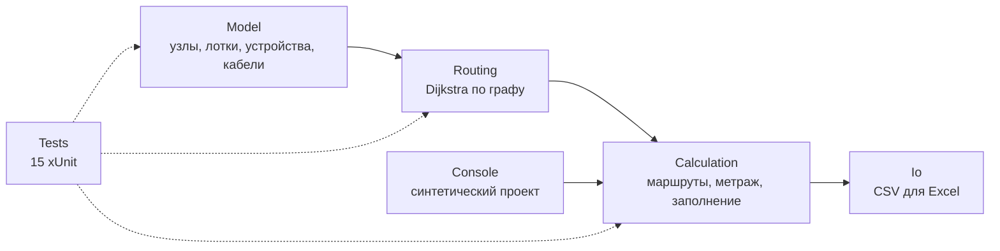

# Cable Routing Demo

Демонстрационный пример трассировки кабельных линий по лоткам для проектирования
СКС и видеонаблюдения. Обезличенный срез архитектуры личного CAD-проекта:
маршрутизация, метраж кабеля, заполнение лотков и выгрузка в CSV.

Полный проект приватный. Здесь — оригинальный код на синтетических данных,
который показывает подход к модели, алгоритмам и тестированию.

> Все данные вымышленные. Код демо не содержит legacy-кода и данных заказчика.
> Подробности — [NOTICE.md](NOTICE.md).

## Что показывает

- Поиск кратчайшего пути по графу лотков (Dijkstra).
- Метраж кабеля по приложениям с запасом на разводку.
- Заполнение лотков по сечению кабелей и настраиваемому порогу.
- Выгрузка CSV для Excel: `;`, UTF-8 с BOM.
- 15 xUnit-тестов и сборка в GitHub Actions.

## Запуск

Нужен .NET 10 SDK.

```bash
dotnet run --project src/CableRouting.Demo.Console
dotnet test
```

В демо используется .NET 10, чтобы запускаться без AutoCAD. Приватный проект
собран под `net48` и managed ObjectARX: это требование AutoCAD 2022–2024.

Демо создаёт синтетический проект: 2 шкафа, 7 розеток (одна — на изолированном
узле), 3 камеры, 10 участков лотка. Один кабель специально оставлен без пути —
видно обработку «нет маршрута».

Фрагмент вывода:

```text
--- Маршруты ---
K-SCS-06     S06   -> CAB-A   24.53 м  N-FAR -> N-FL-1 -> N-BB-1 -> N-CAB-A
K-SCS-99     S99   -> CAB-A  НЕТ ПУТИ  Между узлами 'N-ISOLATED' и 'N-CAB-A' нет пути по трассам.

--- Метраж кабеля ---
Приложение          Кабелей   Длина, м    Макс, м
Видеонаблюдение           4      79.47      24.53
СКС                      10     211.87      24.53
Итого                    14     291.34
Без маршрута: 1

--- Заполнение лотков ---
T08      CORRUGATED-20        8.49        4    135.09   54.04% OVER
Перегружено: 1, максимум: 54.04%
```

## Архитектура



- `Model` — предметная модель: узлы трассы, участки, устройства, кабели.
- `Routing` — кратчайший путь по неориентированному графу трасс.
- `Calculation` — маршруты кабелей с запасом, агрегация метража, заполнение лотков.
- `Io` — CSV-выгрузка.
- `Console` — демо-сценарий на синтетическом проекте.
- `Tests` — xUnit-тесты чистой логики без AutoCAD.

Подробнее — [docs/architecture.md](docs/architecture.md).

## Метрики реального проекта

Это метрики приватного проекта, а не этого демо. Они показывают масштаб задачи,
которую пришлось решать: паритет с исходной версией, golden-регрессия, автотесты.

| Метрика | Значение |
|---|---|
| Паритет длин с исходной версией на эталонном чертеже | **3809/3809 = 100%** |
| Задач трассировки без замечаний | **117/117** |
| Автотесты | **254/254** (xUnit) |
| Golden-регрессия на headless AutoCAD | **19 наборов** |
| Скорость трассировки | **6,2 с** против 18,2 с у исходной версии |
| Релизы | **5** (0.9–1.1.1) |
| Полевая проверка | реальный проект, 5 шкафов |

Подробнее — [docs/metrics.md](docs/metrics.md).

## Кейс

Задача, ограничения, подход и результат — [docs/case-study.md](docs/case-study.md).

## Чего здесь нет

- AutoCAD API, ObjectARX, legacy-кода и чертежей заказчика.
- Excel Interop и шаблонов заказчика.
- Полного приватного проекта.

## Лицензия

Код демо — MIT, см. [LICENSE](LICENSE). Приватный проект и его legacy-код
не входят в репозиторий и не распространяются под этой лицензией.
