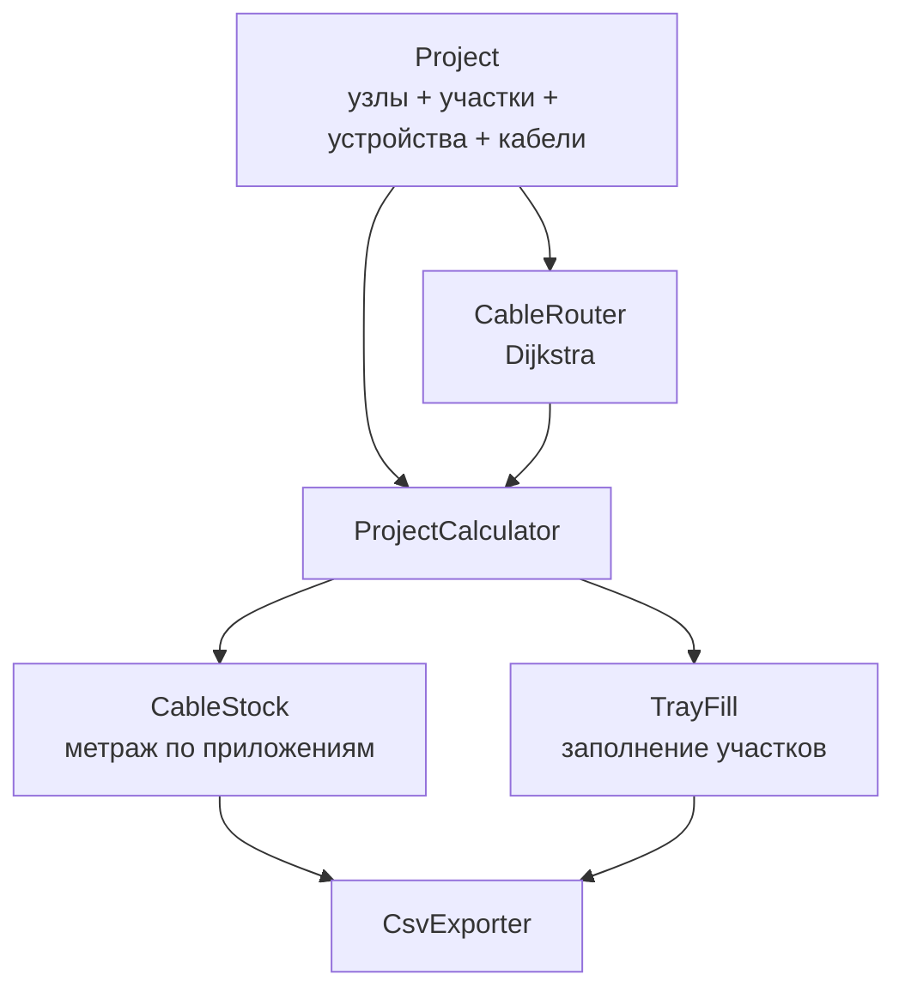

# Архитектура демо

## Что это

Демо повторяет разделение, которое используется в приватном проекте:

| Слой приватного проекта | Демо | Ответственность |
|---|---|---|
| Слой данных | `CableRouting.Demo.Core` | Модель, маршрутизация, расчёты |
| Плагин | `CableRouting.Demo.Console` | Запуск сценария, вывод |
| Спецификации | `CableRouting.Demo.Core/Io` (упрощённо) | Экспорт отчётов |
| Тесты | `CableRouting.Demo.Tests` | Тесты чистой логики |

В приватном проекте слой данных не ссылается на AutoCAD: команды и работа с
чертежом живут в плагине, а алгоритмы можно проверять без запущенного CAD.
Это же разделение позволяет гонять golden-регрессию на headless AutoCAD
(`accoreconsole`) и держать 254 быстрых xUnit-теста.

В демо AutoCAD нет вообще: вместо чертежа — синтетический `Project`, вместо
команд — консольный сценарий. Это делает алгоритмы воспроизводимыми и
проверяемыми на любой машине.

## Поток данных

### Маршрутизация

`CableRouter` строит неориентированный граф: узлы — `TrayNode`, рёбра — `TraySegment`.
Вес ребра — евклидова длина между узлами в миллиметрах. Для поиска используется
`PriorityQueue<string, double>` (Dijkstra).

Результат — `RouteResult`: найден ли путь, список узлов, список участков и длина.
Если пути нет, возвращается `Unreachable` с понятной ошибкой, а не исключение:
в реальном проекте недостижимая розетка — это диагностика, а не падение.

### Метраж кабеля

`ProjectCalculator` для каждого кабеля:

1. Находит устройства по `FromDeviceId`/`ToDeviceId`.
2. Строит маршрут между их узлами.
3. Считает длину: геометрическая длина × (1 + запас %) + фиксированный запас на два конца.
4. Группирует результат по приложению (СКС, видеонаблюдение).

Нерассчитанные кабели не смешиваются с рассчитанными: они попадают в
`UnroutedCables`, чтобы отчёт не выглядел «полным» при потере маршрута.

### Заполнение лотков

Для каждого кабеля площадь сечения считается как `π × (d/2)²`. Затем площадь
добавляется каждому участку на маршруте. Заполнение — отношение суммы площадей
к полезной площади участка. Если процент выше порога (`TrayFillLimitPercent`,
по умолчанию 50%), участок помечается как перегруженный.

Это упрощение: в реальном проекте учитываются типы трасс, профили, запасы и
ограничения по количеству кабелей. Демо показывает сам принцип и структуру отчёта.

## Почему это тестируемо

Все расчёты — чистые функции над моделью. В тестах нет AutoCAD, файлов и сети:

- маршрутизация проверяется на маленьких графах;
- метраж — на известных длинах и запасах;
- заполнение — на известных диаметрах и площадях;
- CSV — на временном файле.

Именно эта граница позволяет в приватном проекте держать быстрые тесты отдельно
от golden-регрессии, которой нужен реальный AutoCAD.
